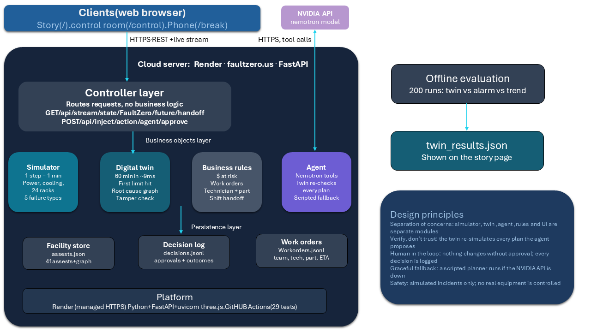

# FaultZero

[](https://github.com/saroshaprasla/FaultZero/actions/workflows/tests.yml)

**See the chain before it breaks.** FaultZero predicts how a data center failure will spread over the next hour, tests fixes in a live digital twin, and lets an operator approve the one that works.

HackUTD 2026: Zero Day · Tracks: NMC², CBRE, NVIDIA, HackUTD Design · MLH: GoDaddy Registry domain, Tiger Data

Team: Sarosha, Binitha, Naomi

**Live app: [faultzero.us](https://faultzero.us)** · break it from your phone at [faultzero.us/break](https://faultzero.us/break)

**Demo video:** <!-- VIDEO -->coming soon · **Devpost:** [FaultZero on Devpost](https://devpost.com/software/codered-teirf1) · **Code:** this repo

| ⏱ 12 min | 🚨 141 / 141 | 🧪 30% wrong physics | 🛡 15 / 15 | ⚡ ~9 ms | ✅ 29 tests |
| :---: | :---: | :---: | :---: | :---: | :---: |
| median head start over the facility alarm | overheating incidents warned in advance (alarm: 0) | still 14.5+ min of warning | hidden sensor attacks caught (alarm: 0) | to simulate the next 60 minutes | passing, every push |

---

## Why we built this

Data center outages are expensive and getting more so. In Uptime Institute's latest outage analysis, **57% of operators said their most recent major outage cost more than $100,000, and 1 in 5 said it cost over $1 million** ([Uptime Institute, 2026](https://www.businesswire.com/news/home/20260513289344/en/Uptime-Announces-Annual-Outage-Analysis-Report-2026)). **Power and cooling problems caused about two-thirds of impactful outages** (54% power, 13% cooling) ([DCD, 2024](https://www.datacenterdynamics.com/en/news/uptime-institute-outages-in-2024-less-frequent-and-severe-but-more-expensive/)).

Most of these outages aren't one failure. They're a chain: a chiller trips, cooling units warm up, racks overheat. The alarm fires only after a temperature limit is crossed, so the operator is always reacting. We wanted to give operators a head start.

## What it does

1. Watches a live data hall: utility power, generator, UPS, PDUs, chillers, cooling units and 24 server racks
2. The moment something fails, a **digital twin** plays the next 60 minutes forward and shows what fails next, when, and why
3. An **NVIDIA Nemotron agent** investigates the incident and tests fixes in the twin
4. Every proposed plan is **re-verified by the twin** before an operator sees it: racks saved and illustrative dollars at risk
5. The operator **approves or dismisses**; an approval creates a work order with a team, technician, ETA and spare part
6. A **time scrubber** plays the next hour with or without the fix
7. A **tamper check** catches sensors that were hacked to hide a hot rack
8. **End shift** writes a handoff for the next operator
9. Judges can **break it from their phone** with a QR code

## How it works




```
sensor readings -> self-calibration -> digital twin (next 60 min) -> cascade + root cause -> control room
       |                                      |
       v                                      v
Tiger Data hypertable              Nemotron agent -> plans -> twin re-verifies -> operator approves -> work order
```

## Pages

| Page | Path | What it is |
| --- | --- | --- |
| Story | `/` | Scroll-driven intro: one night in a data hall going wrong |
| Control room | `/control` | 3D twin, cascade timeline, agent plans, time scrubber, shift handoff |
| Break my data center | `/break` | Phone page from the QR code that injects failures |

## The simulated facility

| Part | Count | Fails as |
| --- | --- | --- |
| Utility feed + backup generator | 1 + 1 | Grid loss |
| UPS units, PDUs | 2, 4 | Battery runs out when the grid and generator are down |
| Chillers | 3 (1 standby) | Trip, or partial loss of capacity |
| Cooling units (CRAH) | 6 | Fan wearing out |
| Server racks | 24 (rows A to D) | Overheat above 27°C (warning) and 32°C (critical) |
| Rack sensors | 24 | Go silent, or get spoofed to hide heat |

Failures have an adjustable **severity** (30% to 100%). Operators can start the backup chiller, raise fan speeds, start the generator, shift load off a row, or isolate a rack.

## The AI

| Part | What it does | Why it's trustworthy |
| --- | --- | --- |
| Digital twin | Copies the facility and steps it 60 minutes ahead | Reads the cause (broken equipment), not just rising temperatures |
| Cascade engine | Records the first limit crossing per asset and walks the dependency graph for the root cause | Every prediction says *because X failed* |
| NVIDIA Nemotron agent | Uses 6 tools: incident, forecast, asset, mitigations, simulate plan, submit plans | Never reports its own numbers; every plan is re-simulated and ranked by the twin. Benchmarked below |
| Probabilistic forecast | Runs 24 possible futures with different failure severities and noise, reports a probability and a likely range | Tested for honesty: every 90%+ call came true, every ≤10% call did not |
| Self-calibration | Infers how bad a failure is (e.g. a chiller at 38% capacity) from the last two sensor readings | The twin is never told the answer; the live forecast runs on what sensors reveal |
| Scripted planner | Runs the same tools if the NVIDIA API is unreachable | The demo never breaks |

## Results

200 random failures (random equipment, severity 30% to 100%). We compared four ways of warning an operator. The **handicapped twin** gets reseeded noise and mis-estimates each failure's severity by up to 30%. The **self-calibrating twin** is never told the severity at all: it estimates it from sensor readings (`backend/calibrate.py`).

| Of 141 equipment failures that overheated a rack | Fixed alarm | Trend-line forecast | Handicapped twin | Self-calibrating twin |
| --- | --- | --- | --- | --- |
| Warned before overheating | 0 | 141 | 141 | 141 |
| Median warning time | 0 min | 9 min | **12 min** | **11 min** |
| Warned 10+ minutes ahead | 0 | 68 | **101** | **89** |
| Warned the minute the equipment failed | 0 | 0 | **94** | 36 |

- The twin warned earlier than the trend line in **133 of 141** cases
- Hacked or silent sensors: the alarm and trend line caught **0**; the tamper check flagged **all 15** that overheated a rack
- **No false alarms** in 100 calm runs, for every method

### Are the forecast's probabilities honest?

The console doesn't just say *"a rack overheats in 9 min"*. It runs 24 possible futures and says *"88% chance this hour, likely in 8–12 min"*. We checked those numbers against 150 incidents (`sim/evaluate_ensemble.py`), forecasting from sensor readings only:

| | Physics matches the twin | Real building 30% worse |
|---|---|---|
| "90%+ likely" calls that came true | 57 / 57 | 75 / 75 |
| "10% or less" calls that came true | 0 / 72 | 0 / 57 |
| Brier score (0 = perfect, 0.25 = coin flip) | 0.020 | 0.017 |
| Median timing error | 0 min | 2 min |
| Real minute inside the 80% range | 98.5% (cautious) | 27% (too narrow) |

The probability stays reliable even when our physics is wrong. The timing range does not: with 30% worse physics it is off by about 2 minutes and too narrow. That is the clearest sign of what a real deployment needs first: fitting the twin's physics to the building.

### Does the AI agent actually help?

We ran 16 incidents (half of them two failures at once) three ways: do nothing, a hand-written expert playbook, and NVIDIA Nemotron planning on its own with tool calls (`sim/agent_benchmark.py`). Every plan was re-simulated by the twin, so these are verified outcomes.

| | Do nothing | Expert playbook | Nemotron agent |
| --- | --- | --- | --- |
| Incidents where every rack was saved | 0 / 16 | 16 / 16 | 15 / 16 |
| Total exposure across the 16 incidents | $236,170 | $0 | $870 |
| Median time to a plan | | instant | 6 s |
| Plans tested in the twin per incident | | 4.8 | 3.4 |
| Times the model failed and fell back | | | 0 |

Nemotron was never told the strategy, yet it matched the hand-written playbook in 15 of 16 incidents and cut exposure by 99.6%. In one compound incident its plan was slightly worse. That is exactly why FaultZero keeps the playbook as a safety net and verifies every plan in the twin before a human sees it: the agent brings flexibility, the twin brings trust.

### What if our physics is wrong?

The biggest risk of any digital twin is that the real building doesn't behave like the model. So we changed the simulated building's physics while both twins kept assuming the original values, and reran 120 incidents per scenario (`sim/robustness.py`).

| Real building vs the twin's model | Fixed alarm | Trend line | Handicapped twin | Self-calibrating twin |
| --- | --- | --- | --- | --- |
| Matches the model | 0 min | 15.5 min | **20 min** | **19 min** |
| Racks heat 30% faster | 0 min | 14.5 min | **18.5 min** | **17.5 min** |
| Cooling responds 30% slower | 0 min | 16 min | **21 min** | **20 min** |
| Chiller failures 30% worse | 0 min | 11.5 min | **15.5 min** | **14.5 min** |
| All three at once | 0 min | 11.5 min | **15.5 min** | **14.5 min** |

Median minutes of warning before a rack overheats. Every method that warned at all warned in 100% of incidents. Model error costs the twin a few minutes, but it stays ahead of the trend line in every scenario.

Reproduce: `python sim/evaluate_twin.py`, `python sim/robustness.py`, `python sim/evaluate_ensemble.py` and `python sim/agent_benchmark.py` (needs an NVIDIA API key). Results are saved as JSON in `sim/`.

We also trained a machine-learning forecaster (`sim/evaluate.py`). It did worse than a simple trend line, because it only sees temperatures after they start rising. That result is why FaultZero models the cause instead of forecasting the symptom.

**Honest limitation:** all data is simulated. The robustness test and self-calibration show the approach tolerates model error, but a real deployment would still need the twin fitted to the building's own sensor history.

## The hard parts we solved

- **Predicting a chain, not a number.** The twin deep-copies the whole facility and steps it 60 minutes ahead in ~9 ms, so it can run on every live update and inside every plan the agent tests.
- **Root cause, not just symptoms.** Every predicted failure walks the power and cooling dependency graph back to what started it, so the operator reads *"Row C passes 32°C in 11 min, because Chiller 2 tripped"*.
- **An agent you can trust.** Nemotron proposes plans through tool calls, but the numbers on every card come from re-simulating the plan in the twin. If its explanation quotes different numbers, we replace it with the verified one.
- **Never a dead demo.** If the NVIDIA API is unreachable, a scripted planner runs the same tools and the same verification.
- **Seeing what sensors hide.** A spoofed sensor reads "fine" while its rack overheats. We flag it from the power draw jump against a flat temperature reading.
- **One live stream for everything.** Server-Sent Events push each simulated minute, the cascade and every agent step to the 3D view, timeline and plan cards at once.
- **Probabilities you can check.** A 24-future ensemble runs in about 60 ms, and we measured whether its probabilities come true instead of just displaying them.
- **A twin that calibrates itself.** It inverts its own physics: two chilled-water readings are enough to estimate a chiller's remaining capacity within a few percent, so the forecast runs on evidence, not on the simulator's hidden truth.
- **History in a time-series database.** Every simulated minute of all 41 assets goes to a Tiger Data hypertable through a non-blocking background writer; the console charts any rack with `time_bucket()` queries. If the database is down, the demo doesn't notice.
- **Tested on every push.** 29 automated tests run in GitHub Actions and cover the twin, the cascade, calibration, the agent, the business rules and the live API. They caught a real sign error in our calibration formula before it shipped.
- **Honest evaluation.** We tested against two baselines on 200 incidents, handicapped our own twin, and reported where our ML model lost.

## Responsible design

- A human approves every action, and every decision is logged
- It doesn't control any real equipment; all incidents are simulated
- Agent numbers are always verified by the twin, never taken from the model's text
- Dollar figures are labeled illustrative ($1,000 per rack-hour above 27°C)
- The judge page has a cooldown, so one person can't spam failures

## Repo layout

| Folder | What's in it |
| --- | --- |
| `backend/` | Facility simulator, digital twin and cascade engine, self-calibration, Nemotron agent, Tiger Data history, FastAPI server |
| `business/` | Dollars at risk, work-order dispatch, shift handoff |
| `frontend/` | 3D control room (three.js) and story page |
| `phone/` | Judge "break my data center" page |
| `sim/` | Evaluation, robustness test, forecast honesty test, agent benchmark, trend-line baseline, ML experiment |
| `tests/` | 29 automated tests (`python -m pytest tests -q`) |
| `data/` | Facility layout and decision logs |
| `docs/` | Data formats, API and architecture diagram |

## How to run

```bash
python3 -m venv .venv
source .venv/bin/activate
pip install -r requirements.txt
python -m uvicorn backend.main:app --host 0.0.0.0 --port 8000
```

Open http://localhost:8000. Optional `.env` settings:

```
NVIDIA_API_KEY=your-key         # use Nemotron; without it the scripted planner runs
PUBLIC_URL=https://your.domain  # QR code points to your public address
TIGER_URL=postgres://...        # store facility history in Tiger Data (optional)
```

Run the tests with `python -m pytest tests -q`.

**Deployment:** the live app runs on Render (free web service, auto-deploys on every push) at [faultzero.us](https://faultzero.us), a domain registered through the MLH GoDaddy Registry offer. History is stored in a free Tiger Cloud service.

## Team

- **Sarosha:** digital twin, cascade engine, Nemotron agent, server, 3D control room and story page
- **Binitha:** forecasting baseline, model evaluation, presentation
- **Naomi:** business impact, work-order dispatch, judge phone page, domain

## What's next

- Fit the twin to real building telemetry (BACnet / Modbus), using the Tiger Data history as training data
- Real weather and IT load forecasts feeding the twin
- Send work orders straight to maintenance systems
- Multiple data halls and sites

## Open-source resources

- [FastAPI](https://fastapi.tiangolo.com/) · [Uvicorn](https://www.uvicorn.org/)
- [three.js](https://threejs.org/)
- [NVIDIA API catalog (Nemotron)](https://build.nvidia.com/) · [OpenAI Python client](https://github.com/openai/openai-python)
- [NumPy](https://numpy.org/) · [scikit-learn](https://scikit-learn.org/) · [pytest](https://pytest.org/)
- [Tiger Data / TimescaleDB](https://www.tigerdata.com/) · [psycopg](https://www.psycopg.org/)
- [Render](https://render.com/) hosting
- [python-qrcode](https://github.com/lincolnloop/python-qrcode)

## Sources

- [Uptime Institute Annual Outage Analysis 2026 (Business Wire)](https://www.businesswire.com/news/home/20260513289344/en/Uptime-Announces-Annual-Outage-Analysis-Report-2026)
- [Uptime Institute outages in 2024 (DatacenterDynamics)](https://www.datacenterdynamics.com/en/news/uptime-institute-outages-in-2024-less-frequent-and-severe-but-more-expensive/)
